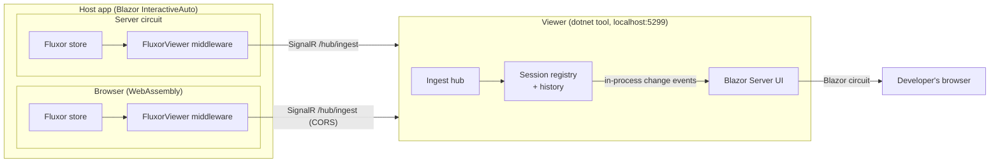

# Architecture

Fluxor Viewer lets a developer watch, in real time, the Actions dispatched in a Fluxor app and the resulting Feature states — without a browser extension (see [ADR 0001](adr/0001-own-viewer-instead-of-redux-devtools.md)). Vocabulary follows [GLOSSARY.md](../GLOSSARY.md).

## Overview



Data flows one way: middleware → Viewer. The Viewer never sends commands to the host app ([ADR 0003](adr/0003-read-only-one-way-reporting.md)).

## Components

| Project | Kind | Responsibility |
|---|---|---|
| `src/FluxorViewer.Protocol` | NuGet (`net10.0`) | Message contracts and protocol version. Shared by both sides so they can't drift. |
| `src/FluxorViewer.Middleware` | NuGet (`net10.0`, Fluxor 6.x) | Fluxor `IMiddleware` that observes the store and reports to the Viewer. |
| `src/FluxorViewer.Server` | `dotnet tool` (`fluxor-viewer`) | ASP.NET Core app: ingest hub, in-memory Session history, Blazor Server UI. |
| `samples/AutoSample` | Sample | InteractiveAuto app (Server + `.Client`) with a few Features, used for manual testing. |
| `tests/FluxorViewer.Middleware.Tests` | Tests | Middleware against a real Fluxor store with a fake transport. |
| `tests/FluxorViewer.Server.Tests` | Tests | `WebApplicationFactory` + real SignalR client driving the ingest hub. |

## Middleware

### Registration

```csharp
services.AddFluxor(o => o
    .ScanAssemblies(typeof(Program).Assembly)
    .UseFluxorViewer(v => {
        v.ServerUrl  = "http://localhost:5299";          // default
        v.AppName    = "MyApp";                          // default: entry assembly name
        v.BufferSize = 1000;                             // default
        v.Enabled    = builder.HostEnvironment.IsDevelopment();
        v.IgnoreAction(a => a is TimerTickAction);
    }));
```

When `Enabled` is false the middleware does nothing: no connection, no serialisation. The same registration is used on both the Server project and the `.Client` project of an InteractiveAuto app.

### Lifecycle

1. **`InitializeAsync(dispatcher, store)`**: generate a `SessionId` (GUID, one per store instance), detect `Runtime` (`OperatingSystem.IsBrowser()` → `WebAssembly`, otherwise `Server`), capture the state reference of every Feature in `store.Features`, and start the background sender.
2. **`AfterDispatch(action)`**: runs after reducers. Assign the next `Sequence`, compare each Feature's `GetState()` by reference against the last captured one (Fluxor state is immutable), and, while connected, enqueue the Action and the **changed** Features' states as references. Nothing is serialised here. Ignored Actions update the captured references but aren't enqueued.
3. **Background sender**: reads from a `Channel` bounded at `BufferSize`, sends up to 100 queued Actions per `Actions` call (whatever is ready, no linger), and sends them over SignalR. On every (re)connect it first sends a **Snapshot** of all Features, built from the captured references and the last `Sequence` (copied together under one lock, so it matches the Actions that follow), then whatever is still buffered. It serialises each message just before sending. Before the first connect nothing is enqueued, since the Snapshot already covers it. `InitializeAsync` never waits for the connection.
4. **Dispose**: the middleware is scoped like the store, so when the scope ends (e.g. a Blazor circuit closes) it cancels any pending connect and closes the hub connection, and the Viewer sees the Session disconnect.

### Safety guarantees

- `AfterDispatch` never awaits or serialises; it only compares references and writes to the channel. Any exception inside it is caught.
- The channel is bounded (`BufferSize`). When it's full, `AfterDispatch` stops queueing and counts the skipped Actions; once the sender has drained what's queued it sends a fresh Snapshot carrying that `DroppedCount`, so the Viewer records a Resync instead of silently reconstructing wrong state.
- Serialisation uses System.Text.Json with `ReferenceHandler.IgnoreCycles` and a max depth. Any failure for a single Action or Feature becomes `{"$error": "<message>"}`; nothing throws into the host app.
- Connection failures retry with backoff forever, silently (logged at Debug).
- In WebAssembly there are no blocking threads; the sender is a plain async loop.

## Protocol

Each Snapshot carries `ProtocolVersion`. The Viewer rejects a Snapshot with a different major version (logged once per Session) and the middleware logs the rejection as a warning. Actions don't carry the version: they're only accepted after a compatible Snapshot on the same connection.

```text
Snapshot
  ProtocolVersion, SessionId, AppName, Runtime (Server|WebAssembly),
  StartedAt, LastSequence, DroppedCount,
  Features: [ { Name, StateType, StateJson } ]

ActionRecorded
  SessionId, Sequence, Timestamp,
  ActionType, ActionJson,
  ChangedFeatures: [ { Name, StateType, StateJson } ]
```

Hub methods on `/hub/ingest`: `Snapshot(Snapshot)` and `Actions(ActionRecorded[])`. One hub connection per Session: the first accepted Snapshot binds the connection to its `SessionId`, and later Snapshots and Actions on it must carry the same one. Rejections are `HubException`s and leave the connection open. CORS allows `localhost`, `127.0.0.1` and `[::1]` origins on any port so WebAssembly apps can connect. The maximum message size is 32 MB (SignalR's default of 32 KB is too small for real Snapshots).

Why changed-Features-only plus Snapshots instead of full state every time: see [ADR 0002](adr/0002-changed-feature-deltas-with-snapshot-resync.md).

## Viewer

### Session registry and history

- `SessionRegistry` holds every Session seen since the Viewer started: info (app name, runtime, started-at, short id), connection status, and its history. In memory only.
- The first Snapshot with a new `SessionId` creates the Session; its info comes from that Snapshot and isn't changed by later ones. The short id (first 4 hex chars) is a display label only and may collide.
- A Session is *connected* while its current hub connection is up; on disconnect it's kept and marked *disconnected*. A reconnect's Snapshot moves the Session to the new connection: a late close from the old one doesn't disconnect it, and Actions still arriving on the old one are dropped (the new Snapshot already covers them).
- **Clear** removes a disconnected Session. A connected Session keeps its current Feature states and last Sequence as its new starting point (in place of a Snapshot) and goes on recording, since the Viewer can't ask the app for a fresh Snapshot.
- Sessions are listed in the order the Viewer first saw them. One lock guards the registry; readers get copies.
- History is an ordered list of entries, capped at N (default 1000, configurable) as a ring buffer:
  - **ActionEntry**: sequence, timestamp, type, payload JSON, set of changed Feature names, and the maps *Feature → state JSON* before and after this Action.
  - **ResyncEntry**: written when a Snapshot arrives for a Session that already has history and either `DroppedCount > 0` or `LastSequence` doesn't follow the last received sequence. Shows how many Actions were lost.
- State reconstruction: each Session has a *current* map (immutable, keyed by Feature name, JSON left unparsed). A Snapshot replaces it. Each Action takes the current map as its *before*, replaces its changed Features to make its *after*, and makes that current. Unchanged Features share the same JSON instance, so per-entry cost is proportional to what changed. Because every entry holds its own before map, evicting old entries or clearing the History never loses the state an entry starts from; Clear keeps the current map.
- The registry raises one in-process `Changed` event, carrying a `SessionAdded`, `SessionStatusChanged`, `EntriesAppended(count)` or `SessionCleared`, which UI components subscribe to. Changes carry only ids: they're hints to re-read the Session, not a log to replay, and may arrive out of order across concurrent callers. Each call raises at most one change of each kind (one `EntriesAppended` per Actions batch), and only when something actually changed; Clear raises `SessionCleared` whether the Session was removed or kept.
- `Changed` is raised after the registry lock is released, synchronously on the calling thread, so handlers must not block and must marshal to their own context (Blazor's `InvokeAsync`). A handler that throws is logged and doesn't affect ingestion or other handlers.

### UI

```
┌──────────────────────────────────────────────────────────────────────┐
│ Session [● MyApp · WebAssembly · 3f2a ▾]  Feature [CounterState ▾] [Clear] │
├──────────────────────────┬───────────────────────────────────────────┤
│ [filter…] [☐ changed only]│ ▸ Payload: { "amount": 1 }                │
│ 41 IncrementAction 10:02 │ ┌ State ┬ Diff ┐                          │
│ 42 FetchDataAction 10:02 │ │ { "count": 3 }   (collapsible tree)     │
│ ⚠ resync — 12 lost       │ │                                         │
│ 55 IncrementAction 10:03 │ │                                         │
│              [▼ 3 new]   │ └─────────────────────────────────────────┘
└──────────────────────────┴───────────────────────────────────────────┘
```

- **Session picker**: all Sessions as "AppName · Runtime · shortId", newest first (most recently seen by the Viewer), marked ●/○ with a green/grey dot for connected/disconnected. The selection belongs to the Viewer tab and follows these rules (`SessionSelection`):
  - Whenever nothing is selected and exactly one Session exists, it's selected. If the selected Session is removed, the selection empties and this applies again; with several Sessions and none selected, the panes say "Pick a Session".
  - If the selected Session is disconnected and a new Session with the same app name and Runtime arrives, the picker switches to it, so reloading the host app keeps you on it. A Server Session never takes over from a WebAssembly one.
  - With no Sessions, the page shows "Waiting for an app to connect…" and a `UseFluxorViewer` snippet with this Viewer's URL.
- **Feature picker**: Features of the selected Session (the keys of its current map), alphabetically ignoring case. The developer's last explicit pick is remembered by name for the Viewer tab and selected in any Session that has it, however the Session changed; otherwise the first Feature is selected, without forgetting the pick (`FeatureSelection`). Disabled with no Session selected, and shows "No Features" for a Session without any.
- **Action list**: every Action, oldest first, as sequence · Action type short name · local time `HH:mm:ss.fff`, virtualised with a fixed row height (`ActionList`). The short name is the last segment of the readable type name the middleware sends, in generic arguments too (`LoadedAction<Item>`); a nested type's enclosing type can't be told apart from a namespace, so it's dropped as well, and the full name shows on hover.
  - Actions that didn't change the selected Feature are dimmed but selectable; a "changed only" toggle hides them (disabled without a selected Feature). A text box filters by short name, case-insensitive. Both belong to the Viewer tab and survive switching Session; "Show all" clears them when nothing matches.
  - Clicking a row selects the Action, by Sequence, and the selection is kept while its row is hidden. Follow mode (below) decides the selection otherwise.
  - Resync marker rows arrive with IN-5.
- **Right pane**: payload strip for the selected Action; **State** tab = the selected Feature's state *after* the selected Action, or the Session's current state with no Action selected, under a header `StateType · after #N ActionType` (or `· current`); **Diff** tab = before → after rendered with `jsondiffpatch` via JS interop, or "No change to <Feature>".
  - The state is a JSON tree, a recursive Blazor component over `JsonDocument` (shared with the payload strip) that renders a node's children only once it's expanded. Two levels are open by default; arrays over 100 items are split into collapsed ranges of 100. Properties keep the order received and numbers their raw text. The "current" view re-renders as Actions arrive.
  - Expand/collapse is stored only as the developer's explicit toggles, keyed by JSON path, per Feature name, for the Viewer tab, so they carry across Actions and Sessions wherever the path exists and are kept while it doesn't.
  - A Feature state that is exactly `{"$error": "…"}` shows as an error instead of a tree; a Feature missing from the selected Action's state shows "<Feature> didn't exist at this point".
  - The State/Diff tab choice belongs to the Viewer tab and survives switching Action, Feature and Session.
  - The **Diff** tab's header reads `StateType · #N ActionType · before → after`. Which message or diff it shows is decided on the server: not a Changed Feature → "No change to <Feature>"; before and after JSON identical as text → "<Feature> was replaced with an identical state"; either side `{"$error": …}` → the error; missing after → "didn't exist at this point"; missing only before → diffed against nothing (all added); no Action selected → "Select an Action to see what it changed". Otherwise both JSON strings go to `jsondiffpatch` in the browser, which matches array items by `Id`/`id` (else position), doesn't diff strings character by character, and hides unchanged values unless "Show unchanged" (remembered for the Viewer tab) is ticked. If it finds no difference in differing text (numbers beyond 2^53 lose precision in `JSON.parse`), the tab says the differences are beyond what the diff can show. The diff is recomputed only when the Action, Feature or "Show unchanged" changes.
  - `jsondiffpatch` is a pinned npm dependency whose ESM build and CSS the npm/MSBuild step copies into `wwwroot` (gitignored), so the tool works offline; its classes are restyled in `Styles/app.css` for both themes.
- **Follow mode** (`ActionList`): on by default, so the newest *visible* row stays selected as Actions arrive and as the filter or toggle changes; with no rows visible nothing is selected and the State tab shows current.
  - Selecting any other row pauses it. Selecting the newest visible row, or clicking the pill, resumes it, and so does losing the selection (switching Session, Clear, the cap evicting the selected Action).
  - While paused, a "▼ N new" pill floats at the bottom right of the list, counting the visible rows newer than the last Sequence in the History when it paused; it's hidden while N is 0.
  - While following, the list scrolls to the bottom (a collocated JS module, `ActionListPane.razor.js`) whenever the newest visible row changes or follow mode turns on. While paused it never scrolls by itself, and scrolling by hand doesn't pause it.

Updates reach the developer's browser through the Blazor Server circuit; no extra hub is needed for the UI.

The UI is interactive server rendering with prerendering off (a prerender would subscribe to the registry twice). Components re-read the registry when it raises `Changed`, at most about 10 times a second (`RenderThrottle`: a change after a quiet 100 ms renders at once, later ones in the window become one render at its end), so a burst of Actions doesn't flood the circuit; the page ignores `EntriesAppended` for Sessions other than the selected one, and re-reads on it for the selected one because a Snapshot on a still-connected connection raises no change but may bring different Features.

Styling is Tailwind v4, utility classes in the markup with `@apply` only for repeated pieces, and dark mode following the OS. `Styles/app.css` is built into `wwwroot/app.css` (gitignored) by an incremental MSBuild target that runs `npm ci` and the Tailwind CLI, so building the Viewer needs Node; the packaged tool ships the built CSS. During development, run `npm run watch` in `src/FluxorViewer.Server` alongside `dotnet watch`.

### Hosting

`fluxor-viewer [--port 5299] [--history 1000]` binds to `localhost` only and prints the URL. There's no authentication; it's a local development tool.

## InteractiveAuto notes

- Prerendering doesn't start the store (Fluxor's `StoreInitializer` initialises after first render), so no Session is created for prerender.
- One tab may produce a Server Session and later a WebAssembly Session. They are deliberately separate Sessions ([ADR 0004](adr/0004-separate-sessions-per-store-under-interactive-auto.md)).
- Blazor Server: one Session (and one hub connection) per circuit.

## Out of scope for v1

Time-travel, replay, dispatching from the Viewer, import/export, persistence across Viewer restarts, correlating Server and WebAssembly Sessions from the same tab, authentication, non-localhost deployment.
