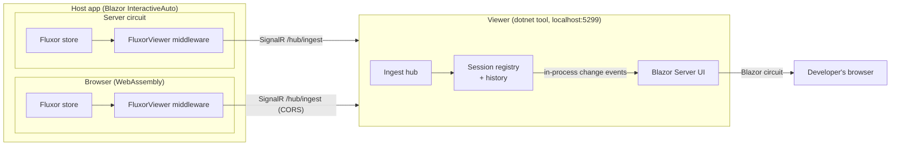

# Architecture

Fluxor Viewer lets a developer watch, in real time, the Actions dispatched in a Fluxor app and the resulting Feature states — without a browser extension (see [ADR 0001](adr/0001-own-viewer-instead-of-redux-devtools.md)). Vocabulary follows [GLOSSARY.md](../GLOSSARY.md).

## Overview



Data flows one way: middleware → Viewer. The Viewer never sends commands to the host app ([ADR 0003](adr/0003-read-only-one-way-reporting.md)).

## Components

| Project | Kind | Responsibility |
|---|---|---|
| `src/FluxorViewer.Protocol` | NuGet (`net10.0`) | Message contracts, protocol version and JSON limits (`JsonLimits.MaxDepth`, `JsonLimits.MaxMessageSize`). Shared by both sides so they can't drift. |
| `src/FluxorViewer.Middleware` | NuGet (`net10.0`, Fluxor 6.x) | Fluxor `IMiddleware` that observes the store and reports to the Viewer. |
| `src/FluxorViewer.Server` | `dotnet tool` (`fluxor-viewer`) | ASP.NET Core app: ingest hub, in-memory Session history, Blazor Server UI. |
| `samples/AutoSample` | Sample | InteractiveAuto app (Server + `.Client`) with a few Features, used for manual testing. |
| `tests/FluxorViewer.Middleware.Tests` | Tests | Middleware against a real Fluxor store with a fake transport. |
| `tests/FluxorViewer.Server.Tests` | Tests | `WebApplicationFactory` + real SignalR client driving the ingest hub. |

## Middleware

### Registration

```csharp
services.AddFluxor(o => o
    .ScanAssemblies(typeof(Program).Assembly)
    .UseFluxorViewer(v => {
        v.ServerUrl  = "http://localhost:5299";          // default
        v.AppName    = "MyApp";                          // default: entry assembly name
        v.BufferSize = 1000;                             // default
        v.MaxDepth   = 64;                               // default, 1–1024
        v.MaxValueSize = 8 * 1024 * 1024;                // default, bytes, 1 to the 32 MB message limit
        v.Enabled    = builder.HostEnvironment.IsDevelopment();
        v.IgnoreAction(a => a is TimerTickAction);       // any number; see Lifecycle
    }));
```

When `Enabled` is false the middleware does nothing: no connection, no serialisation. The same registration is used on both the Server project and the `.Client` project of an InteractiveAuto app.

### Lifecycle

1. **`InitializeAsync(dispatcher, store)`**: generate a `SessionId` (GUID, one per store instance), detect `Runtime` (`OperatingSystem.IsBrowser()` → `WebAssembly`, otherwise `Server`), capture the state reference of every Feature in `store.Features`, and start the background sender.
2. **`AfterDispatch(action)`**: runs after reducers. Assign the next `Sequence`, compare each Feature's `GetState()` by reference against the last captured one (Fluxor state is immutable), and append the Action and the **changed** Features' states, as references, to the buffer, whether connected or not. Nothing is serialised here. An **Ignored Action**, one matching any `IgnoreAction` predicate (checked before anything else), skips this step entirely: it takes no Sequence, isn't compared or enqueued, and leaves the captured references alone, so the next reported Action carries the Features it changed (and a Snapshot in between, taken from the base, doesn't see them yet). The Viewer isn't told. A predicate that throws counts as false for that Action, the others still apply, and each predicate's first throw in the process is logged at Warning, later ones at Debug.
3. **Buffer and base**: one lock-guarded queue, bounded at `BufferSize`, holds every Action not yet sent, from `InitializeAsync` onwards. Alongside it the middleware keeps the **base**: the Feature state references and `Sequence` just after the last Action that left the buffer (sent, or dropped as the oldest when the buffer was full). It starts as the initial states with `Sequence` 0. Moving an Action out of the buffer copies its changed states into the base, so the base costs no serialisation. See [ADR 0005](adr/0005-snapshot-from-the-base-never-rewinds.md).
4. **Background sender**: its own loop: create a hub connection, start it, send a **Snapshot** of the base (`LastSequence` = the base's `Sequence`, plus `DroppedCount`), then drain the buffer, up to 100 Actions per `Actions` call (whatever is ready, no linger), split so no call exceeds the Viewer's message limit (see Safety guarantees). After any drop it sends a fresh base Snapshot before the next batch. On any failure, or when the connection closes while idle (so a restarted Viewer gets the Session back without waiting for the next Action), it disposes the connection, waits (1 s → 2 s → 4 s → 10 s cap, reset once the Viewer accepts a Snapshot, timed by an injected `TimeProvider`), and starts over with a new connection, which the Viewer binds by the Snapshot's `SessionId`. It serialises each message just before sending. `InitializeAsync` never waits for the connection.
5. **Dispose**: the middleware is scoped like the store, so when the scope ends (e.g. a Blazor circuit closes) it cancels any pending connect and closes the hub connection, and the Viewer sees the Session disconnect.

### Safety guarantees

- `AfterDispatch` never awaits or serialises; it only compares references, appends to the buffer (on overflow, moving the oldest Action into the base) and signals the sender. Any exception inside it is caught.
- The buffer is bounded (`BufferSize`), connected or not. When it's full, `AfterDispatch` drops the oldest Action into the base and counts it; the sender then sends a base Snapshot carrying that `DroppedCount` before the remaining Actions, so the Viewer records a Resync instead of silently reconstructing wrong state. `DroppedCount` is reset only once a Snapshot has been sent successfully.
- A batch leaves the buffer, and the base moves past it, once it's handed to the send; a failed send isn't retried, and the Viewer sees the gap in Sequences. So a Snapshot's `LastSequence` is never less than any Sequence already sent, and the Viewer never rewinds.
- Serialisation uses System.Text.Json with `ReferenceHandler.IgnoreCycles` and `MaxDepth` (default 64, 1–1024). A back-reference becomes `null`, so in the Viewer a cycle looks the same as a real `null`.
- A **Serialisation error** replaces one value, never a message: a Payload or Feature state that fails to serialise (a converter or getter throwing, an unsupported type, too deep) is sent as exactly `{"$error": "<message>"}` and the rest of the Snapshot or Action goes out as normal.
  - The message is the exception's own, which for System.Text.Json includes `Path: $.x`, capped at 500 characters. Exceeding `MaxDepth` gets our own message instead ("Nested deeper than MaxDepth (64) at $.a.b…"), since System.Text.Json's suggests a cycle and `ReferenceHandler.Preserve`.
  - Each failing Action type or Feature is logged at Warning, with the exception, once per process; later failures at Debug.
  - A value whose JSON is over `MaxValueSize` (UTF-8 bytes, default 8 MB) is a Serialisation error naming its size: "Larger than MaxValueSize (8 MB): 12.4 MB". It's written into a buffer that stops keeping it once it's over `MaxValueSize` and only counts the rest, so a huge state costs the time to serialise it, but its JSON is never held whole. Strings are written a chunk at a time, so no single write needs much more room than the chunk, and a value within the cap is serialised once.
  - If building a message fails outside those values, the Action is a Dropped Action: the sender follows it straight away with a Snapshot of the state just after it (built from the base the batch left, with the batch's Changed Features up to it applied), counting it in that Snapshot's `DroppedCount`, then sends the rest of the batch, so the Viewer records a Resync exactly there (ADR 0005). Actions in a row that can't be built share one Snapshot after the last. A Snapshot that can't be built stops the Session. Both are logged at Warning.
- No message exceeds the Viewer's limit (`JsonLimits.MaxMessageSize`, 32 MB):
  - SignalR's JSON protocol escapes minimally by default (`"` as `\"`, non-ASCII as UTF-8), so a value's wire size stays close to its JSON size.
  - A message's size is measured as SignalR will encode it (its default payload options): the message with its values emptied, serialised, plus each Payload and Feature state's encoded size, counted a chunk at a time so no value is copied to measure it.
  - A batch is split by each `ActionRecorded`'s encoded size, packed greedily up to the limit less 64 KB headroom for framing, still at most 100 Actions per call.
  - A Snapshot or single Action still over the limit (e.g. several Features each under `MaxValueSize`) is shrunk to fit: its largest values, by encoded size (an Action's Payload alongside its Changed Features), are replaced one at a time with Serialisation errors ("Left out to stay under the Viewer's 32 MB limit (7.1 MB)") until it fits. Only the message changes; the base keeps the real states. Logged at Warning once per process for each Feature or Action type left out, later at Debug. The Session keeps reporting, and never loops reconnecting.
  - A message still over the limit with every value left out (only possible with enormous Feature names) can't be built: a Snapshot stops the Session and an Action is dropped, as above.
- Not covered: a `StackOverflowException` (e.g. a converter or getter recursing forever) or running out of memory, which .NET can't catch.
- Connection failures retry with backoff forever. The first connection that won't open is logged at Warning, once per process (`ConnectionWarning`, a singleton shared by every Session in the app), naming the `ServerUrl` and the reason and asking whether `fluxor-viewer` is running there, so a first run that shows nothing in the Viewer says why (PK-5); later failures to open, and connections lost after opening, are logged at Debug. Only a rejection by the Viewer (a `HubException` whose message contains `Rejection.Prefix`, which SignalR wraps in its own text; e.g. a protocol version mismatch) or a Snapshot that can't be built stops a Session for good, logged at Warning. Any other `HubException` is an unexpected error in the Viewer (which logs it) and is retried like a lost connection.
- In WebAssembly there are no blocking threads; the sender is a plain async loop.

## Protocol

Each Snapshot carries `ProtocolVersion`. The Viewer rejects a Snapshot with a different major version (logged once per Session) and the middleware logs the rejection as a warning. Actions don't carry the version: they're only accepted after a compatible Snapshot on the same connection.

```text
Snapshot
  ProtocolVersion, SessionId, AppName, Runtime (Server|WebAssembly),
  StartedAt, LastSequence, DroppedCount,
  Features: [ { Name, StateType, StateJson } ]

ActionRecorded
  SessionId, Sequence, Timestamp,
  ActionType, Payload,
  ChangedFeatures: [ { Name, StateType, StateJson } ]
```

Hub methods on `/hub/ingest`: `Snapshot(Snapshot)` and `Actions(ActionRecorded[])`. One hub connection per Session: the first accepted Snapshot binds the connection to its `SessionId`, and later Snapshots and Actions on it must carry the same one. Rejections are `HubException`s and leave the connection open. CORS allows `localhost`, `127.0.0.1` and `[::1]` origins on any port so WebAssembly apps can connect. The maximum message size is 32 MB, `JsonLimits.MaxMessageSize`, shared so the middleware splits and shrinks against it (SignalR's default of 32 KB is too small for real Snapshots). The hub also buffers up to that much from a connection before pausing it (`ApplicationMaxBufferSize`): at SignalR's 64 KB default, receiving a message near the limit took seconds, because the end of the message is searched for again over everything buffered after every 64 KB read.

Why changed-Features-only plus Snapshots instead of full state every time: see [ADR 0002](adr/0002-changed-feature-deltas-with-snapshot-resync.md).

## Viewer

### Session registry and history

- `SessionRegistry` holds every Session seen since the Viewer started: info (app name, runtime, started-at, short id), connection status, and its history. In memory only.
- The first Snapshot with a new `SessionId` creates the Session; its info comes from that Snapshot and isn't changed by later ones. The short id (first 4 hex chars) is a display label only and may collide.
- A Session is *connected* while its current hub connection is up; on disconnect it's kept and marked *disconnected*. A reconnect's Snapshot moves the Session to the new connection: a late close from the old one doesn't disconnect it, and Actions still arriving on the old one are dropped (the new Snapshot already covers them).
- The Viewer keeps at most its **Disconnected Session limit** (`--disconnected`, default 10, 0 allowed) of disconnected Sessions, and records when each one last disconnected (each disconnect replaces the one before, so a Session that reconnected counts from its latest). When a disconnect takes the count past the limit, the Viewer **forgets** the Session that disconnected longest ago: it's removed as Clear removes one, in the same call, so no reader sees more than the limit. Connected Sessions don't count and are never forgotten, and a Session selected in a Viewer tab isn't protected. A forgotten Session that reconnects is unknown to the Viewer, so its Snapshot creates a new Session. Once it has forgotten one, the registry says so with its limit (`ForgottenBeyond`) until the Viewer restarts. Logged at Debug.
- **Clear** removes a disconnected Session; **Clear disconnected** removes every Session disconnected at that moment, from every Host app, and leaves connected Sessions untouched. A connected Session keeps its current Feature states and last Sequence as its new starting point (in place of a Snapshot) and goes on recording, since the Viewer can't ask the app for a fresh Snapshot.
- Sessions are listed in the order the Viewer first saw them. One lock guards the registry; readers get copies.
- History is an ordered list of entries, each with an Id unique within its Session (increasing as entries are appended, never reused, even after Clear), kept within the **History limit** (`--history`, default 1000), which counts Actions and Resyncs alike. Whenever an append takes the History past it, the oldest entries are discarded, and the Session records that it has discarded, with the limit (`DiscardedBeyond`), until it's Cleared:
  - **ActionEntry**: sequence, timestamp, type, payload JSON, set of changed Feature names, and the maps *Feature → state JSON* before and after this Action.
  - **ResyncEntry**: the Snapshot's `LastSequence`, the time the Viewer received it, how many Actions were lost and the Snapshot's Feature states as its *after*. Lost is `DroppedCount` for a new Session (Actions before its first Snapshot that weren't dropped predate the Viewer) and `max(DroppedCount, LastSequence − last received Sequence)` for a known one, including one just Cleared. A ResyncEntry is appended whenever lost > 0, whether or not the History is empty, and raises `EntriesAppended`.
  - A Snapshot older than the last received Sequence breaks [ADR 0005](adr/0005-snapshot-from-the-base-never-rewinds.md); the Viewer still takes it without rewinding, as a ResyncEntry with no lost count, and logs a Warning once per Session.
  - Actions at or before the last received Sequence are duplicates and ignored. The Viewer doesn't look for missing Sequences between Actions: the middleware follows every loss with a Snapshot (MW-10).
- State reconstruction: each Session has a *current* map (immutable, keyed by Feature name, JSON left unparsed). A Snapshot replaces it. Each Action takes the current map as its *before*, replaces its changed Features to make its *after*, and makes that current. Unchanged Features share the same JSON instance, so per-entry cost is proportional to what changed. Because every entry holds its own before map, discarding old entries or clearing the History never loses the state an entry starts from; Clear keeps the current map.
- The registry raises one in-process `Changed` event, carrying a `SessionAdded`, `SessionStatusChanged`, `EntriesAppended(count)`, `SessionCleared` or `SessionForgotten`, which UI components subscribe to. Changes carry only ids: they're hints to re-read the Session, not a log to replay, and may arrive out of order across concurrent callers. Each call raises at most one change of each kind (one `EntriesAppended` per Actions batch), and only when something actually changed; Clear raises `SessionCleared` whether the Session was removed or kept, and Clear disconnected raises one `SessionCleared` per Session it removes (none if nothing was disconnected); a disconnect that forgets a Session raises `SessionStatusChanged` and `SessionForgotten`.
- `Changed` is raised after the registry lock is released, synchronously on the calling thread, so handlers must not block and must marshal to their own context (Blazor's `InvokeAsync`). A handler that throws is logged and doesn't affect ingestion or other handlers.

### UI

```
┌──────────────────────────────────────────────────────────────────────┐
│ Session [● MyApp · WebAssembly · 3f2a ▾]  Feature [CounterState ▾] [Clear] [Clear disconnected] │
├──────────────────────────┬───────────────────────────────────────────┤
│ [filter…] [☐ changed only]│ ▸ Payload: { "amount": 1 }                │
│ 41 IncrementAction 10:02 │ ┌ State ┬ Diff ┐                          │
│ 42 FetchDataAction 10:02 │ │ { "count": 3 }   (collapsible tree)     │
│ ⚠ resync — 12 lost       │ │                                         │
│ 55 IncrementAction 10:03 │ │                                         │
│              [▼ 3 new]   │ └─────────────────────────────────────────┘
└──────────────────────────┴───────────────────────────────────────────┘
```

- **Session picker**: all Sessions as "AppName · Runtime · shortId", newest first (most recently first seen by the Viewer; disconnecting doesn't move a Session), marked ●/○ with a green/grey dot for connected/disconnected. The selection belongs to the Viewer tab and follows these rules (`SessionSelection`):
  - Whenever nothing is selected and exactly one Session exists, it's selected. If the selected Session is removed (by Clear or Clear disconnected, or forgotten), the selection empties and this applies again; with several Sessions and none selected, the panes say "Pick a Session".
  - If the selected Session is disconnected and a new Session with the same app name and Runtime arrives, the picker switches to it, so reloading the host app keeps you on it. Under InteractiveAuto a WebAssembly Session also takes over from a disconnected Server Session of the same app, since a reload is when WebAssembly takes over; a Server Session never takes over from a WebAssembly one.
  - Once the Viewer has forgotten a Session, the end of the open list carries a disabled option, "Older disconnected Sessions forgotten · the Viewer keeps the last 10" (the configured limit; with a limit of 0, "Disconnected Sessions forgotten · the Viewer keeps none"), until the Viewer restarts. It can't be selected and neither Clear nor Clear disconnected removes it.
  - With no Sessions, the page shows "Waiting for a Host app to connect…" and a `UseFluxorViewer` snippet with this Viewer's URL.
- **Feature picker**: Features of the selected Session (the keys of its current map), alphabetically ignoring case. The developer's last explicit pick is remembered by name for the Viewer tab and selected in any Session that has it, however the Session changed; otherwise the first Feature is selected, without forgetting the pick (`FeatureSelection`). Disabled with no Session selected, and shows "No Features" for a Session without any.
- **Action list**: every Action, oldest first, as sequence · Action type short name · local time `HH:mm:ss.fff`, virtualised with a fixed row height (`ActionList`). The short name is the last segment of the readable type name the middleware sends, in generic arguments too (`LoadedAction<Item>`); a nested type's enclosing type can't be told apart from a namespace, so it's dropped as well, and the full name shows on hover.
  - Actions that didn't change the selected Feature are dimmed but selectable; a "changed only" toggle hides them (disabled without a selected Feature). A text box filters by short name, case-insensitive. Both belong to the Viewer tab and survive switching Session; "Show all" clears them when nothing matches.
  - Clicking a row selects its entry, by Id (a Resync shares its Sequence with the Action before it, and after an older Snapshot an Action's Sequence may appear twice), and the selection is kept while its row is hidden. Follow mode (below) decides the selection otherwise.
  - Once the Session has discarded entries, a quiet note sits between the filter bar and the list: "Older entries discarded · the Viewer keeps the last 1,000 per Session" (the configured limit). It isn't a row, so it can't be selected, the filter and "changed only" never hide it, and Follow mode and the "▼ N new" pill don't count it. A Clear removes it until the limit is passed again.
  - A Resync is a row too: "⚠ resync — N actions lost" ("1 action lost"; "⚠ resync" without a count), the time the Viewer received it, and the lost range (`Actions #43–#54 were lost`) on hover, never reaching back past the last Action received. The filter and "changed only" never hide it. "No Actions yet" and "No Actions match" count Actions only, with any Resync rows still shown beneath.
  - The list is one tab stop (`tabindex="0"`, a `focus-visible` ring; clicking a row focuses it). With it focused, ↑/↓ select the previous/next visible row and Home/End the first/last, exactly as clicking that row would (so landing on the newest visible row, End included, resumes Follow mode); with the selected row hidden, ↑/↓ go to the nearest visible row before/after it in History order, and a key with nowhere to go does nothing. A keydown listener in `ActionListPane.razor.js` stops only those four keys scrolling natively; `ActionList` picks the row, and `scrollRowIntoView` scrolls the least needed to show it, by index × 28px. Other keys keep their native behaviour.
- **Right pane**: payload strip for the selected Action (below); **State** tab = the selected Feature's state *after* the selected Action or Resync, or the Session's current state with nothing selected, under a header `StateType · after #N ActionType` (`· after resync`, or `· current`); **Diff** tab = before → after rendered with `jsondiffpatch` via JS interop, or "No change to <Feature>".
  - The state is a JSON tree, a recursive Blazor component over `JsonDocument` (shared with the payload strip) that renders a node's children only once it's expanded. Two levels are open by default; arrays over 100 items are split into collapsed ranges of 100. Properties keep the order received and numbers their raw text. The "current" view re-renders as Actions arrive.
  - The Viewer parses JSON to depth 1024, the most `MaxDepth` allows. JSON it still can't parse shows as "Couldn't read this state: <message>" instead of a tree, so a bad value never throws while rendering.
  - Expand/collapse is stored only as the developer's explicit toggles, keyed by JSON path, per Feature name, for the Viewer tab, so they carry across Actions and Sessions wherever the path exists and are kept while it doesn't.
  - A Feature state that is exactly `{"$error": "…"}` shows as an error instead of a tree; a Feature missing from the selected Action's state shows "<Feature> didn't exist at this point".
  - The State/Diff tab choice belongs to the Viewer tab and survives switching Action, Feature and Session.
  - The **Diff** tab's header reads `StateType · #N ActionType · before → after`. Which message or diff it shows is decided on the server: not a Changed Feature → "No change to <Feature>"; before and after JSON identical as text → "<Feature> was replaced with an identical state"; either side `{"$error": …}` → the error; missing after → "didn't exist at this point"; missing only before → diffed against nothing (all added); a Resync selected → "History was lost before this point; diff unavailable"; no Action selected → "Select an Action to see what it changed". Otherwise both JSON strings go to `jsondiffpatch` in the browser, which matches array items by `Id`/`id` (else position), doesn't diff strings character by character, and hides unchanged values unless "Show unchanged" (remembered for the Viewer tab) is ticked. If it finds no difference in differing text (numbers beyond 2^53 lose precision in `JSON.parse`), the tab says the differences are beyond what the diff can show. The diff is recomputed only when the Action, Feature or "Show unchanged" changes.
  - The **payload strip** sits above the tabs and only while an Action (not a Resync) is selected. Collapsed, it's one line: the Payload as compact JSON with strings decoded and numbers as received (`PayloadLine`), cut on the server at 500 characters so a large Payload doesn't cross the circuit whole, then by CSS to the width. Expanded, it's a JSON tree at most a third of the screen high, scrolling on its own. Expanded or collapsed belongs to the Viewer tab (collapsed at first); the tree's expand/collapse choices are kept per full Action type. An empty object or array, a scalar or malformed JSON shows on its line without a toggle; a Payload that is exactly `{"$error": …}` shows "Couldn't serialise <Action type>: <message>".
  - `jsondiffpatch` is a pinned npm dependency whose ESM build and CSS the npm/MSBuild step copies into `wwwroot` (gitignored), so the tool works offline; its classes are restyled in `Styles/app.css` for both themes.
- **Follow mode** (`ActionList`): Resync rows count as rows throughout. On by default, so the newest *visible* row stays selected as Actions arrive and as the filter or toggle changes; with no rows visible nothing is selected and the State tab shows current.
  - Selecting any other row pauses it. Selecting the newest visible row, or clicking the pill, resumes it, and so does losing the selection (switching Session, Clear, the History limit discarding the selected entry).
  - While paused, a "▼ N new" pill floats at the bottom right of the list, counting the visible rows appended after the newest entry in the History when it paused; it's hidden while N is 0.
  - While following, the list scrolls to the bottom (a collocated JS module, `ActionListPane.razor.js`) whenever the newest visible row changes or follow mode turns on. While paused it never scrolls by itself, and scrolling by hand doesn't pause it.
- **Clear** (header button, `ClearButton`) clears the selected Session only. It's enabled whenever a Session is selected, except a connected one whose History is already empty.
  - Clicking it swaps the button for an inline prompt in the header, with no dialog and no JS: the text first, then [Clear] [Cancel], so a double-click on Clear can't land on the confirm button. Focus goes to Cancel. The text follows the Session's status as it is now: "Remove disconnected Session MyApp · 3f2a?" or "Clear N Actions from MyApp · 3f2a?", with N counting live ("Clear the History of MyApp · 3f2a?" when it holds only Resyncs).
  - The prompt is cancelled by Cancel, Escape, a change of selected Session (including following a reloaded app), or Clear becoming disabled (e.g. another Viewer tab cleared it first). Clicking elsewhere doesn't cancel it. Confirming calls `SessionRegistry.Clear`, which acts on the status and History at that moment.
  - Afterwards nothing is special to Clear: a removed Session empties the selection and the usual `SessionSelection` rules apply. A kept Session shows "No Actions yet", Follow mode turns back on and the State tab shows current state. The filter, toggle, tree choices and State/Diff tab are kept, and no marker row is added. Every Viewer tab sees it through `SessionCleared`.
- **Clear disconnected** (header button, `ClearDisconnectedButton`) removes every disconnected Session, from every Host app, at once. It's enabled whenever at least one Session is disconnected, whether or not a Session is selected.
  - It shares Clear's inline prompt (`ClearPrompt`): text first, then [Clear] [Cancel], focus on Cancel, Escape cancels. The text counts live: "Remove 3 disconnected Sessions?" ("Remove 1 disconnected Session?"). The prompt closes when no Session is disconnected any more. Confirming calls `SessionRegistry.ClearDisconnected`, which removes whatever is disconnected at that moment.
  - Afterwards the usual `SessionSelection` rules apply: a selected disconnected Session that's removed empties the selection, and a selected connected Session stays selected. The forgotten note stays. Every Viewer tab sees it through `SessionCleared`.

Updates reach the developer's browser through the Blazor Server circuit; no extra hub is needed for the UI.

The UI is interactive server rendering with prerendering off (a prerender would subscribe to the registry twice). Components re-read the registry when it raises `Changed`, at most about 10 times a second (`RenderThrottle`: a change after a quiet 100 ms renders at once, later ones in the window become one render at its end), so a burst of Actions doesn't flood the circuit; the page ignores `EntriesAppended` for Sessions other than the selected one, and re-reads on it for the selected one because a Snapshot on a still-connected connection raises no change but may bring different Features.

Styling is Tailwind v4, utility classes in the markup with `@apply` only for repeated pieces, and dark mode following the OS. `Styles/app.css` is built into `wwwroot/app.css` (gitignored) by an incremental MSBuild target that runs `npm ci` and the Tailwind CLI, so building the Viewer needs Node; the packaged tool ships the built CSS. During development, run `npm run watch` in `src/FluxorViewer.Server` alongside `dotnet watch`.

### Hosting

`fluxor-viewer [--port 5299] [--history 1000] [--disconnected 10]` binds to `localhost` only and prints the URL. There's no authentication; it's a local development tool. `--history` is read as the configuration key `history` (`HistoryLimit`); a bad value stops the Viewer before it listens: it writes one line to stderr and exits with code 1. A value that isn't a whole number of at least 1 says `--history must be a whole number of at least 1, not "<value>".`, and one above 2147483647 says `--history can be at most 2147483647, not "<value>".` `--disconnected` (`disconnected`, `DisconnectedSessionLimit`) is read and checked the same way (`WholeNumberSetting`), except that 0 is allowed: "a whole number of at least 0".

`--port` (`port`, `ViewerPort`) is from 1 to 65535 and says `--port must be a whole number from 1 to 65535, not "<value>".` otherwise; 0 (any free port) is refused, because the Host app's `ServerUrl` needs a port that stays the same between runs. The Viewer listens on `http://localhost:<port>`, set after configuration is read so `--urls` or `ASPNETCORE_URLS` can't widen it, and once listening prints `Fluxor Viewer: http://localhost:<port>` to stdout. A port that's taken stops it with one line to stderr, `Port <port> is already in use. Start the Viewer on another port with --port N, and point the Host app's ServerUrl at it.`, and exit code 1. `--help` or `-h` prints every option with its default (`Usage`) and exits with 0 without starting anything.

The content root is the app's own directory, not the current one: an installed tool starts wherever the developer is, and `wwwroot` and `appsettings.json` sit beside the app.

### Packaging (PK-4)

`tools/pack.sh` packs the Viewer as the `fluxor-viewer` tool (package ID and command) into `artifacts/packages/`, with the same version as Middleware and Protocol. It's meant to be built from source on the developer's own machine and installed from that folder, so nothing is downloaded and run; the build uses the machine's configured NuGet and npm sources, and runs on Windows in Git Bash (`.gitattributes` keeps `*.sh` LF). `tools/check-tool.sh` installs the last packed tool into a temporary folder, runs `--help`, starts it and checks the page and the files it loads are served and not empty; CI runs it after packing. Publishing to nuget.org is PK-6.

## InteractiveAuto notes

- Prerendering doesn't start the store (Fluxor's `StoreInitializer` initialises after first render), so no Session is created for prerender.
- `AppName` defaults to the entry assembly, which differs between the halves (`MyApp` and `MyApp.Client`), so an InteractiveAuto app sets it explicitly in its shared registration to show as one Host app.
- WebAssembly takes over on the next page load once it's downloaded: the first visit runs a Server circuit for the whole tab. On that reload the circuit ends (Blazor's disconnect beacon; if that's lost, Blazor keeps the circuit, and its Session connected, for up to 3 minutes).
- One tab may produce a Server Session and later a WebAssembly Session. They are deliberately separate Sessions ([ADR 0004](adr/0004-separate-sessions-per-store-under-interactive-auto.md)).
- Blazor Server: one Session (and one hub connection) per circuit.

## Out of scope for v1

Time-travel, replay, dispatching from the Viewer, import/export, persistence across Viewer restarts, correlating Server and WebAssembly Sessions from the same tab, authentication, non-localhost deployment.
